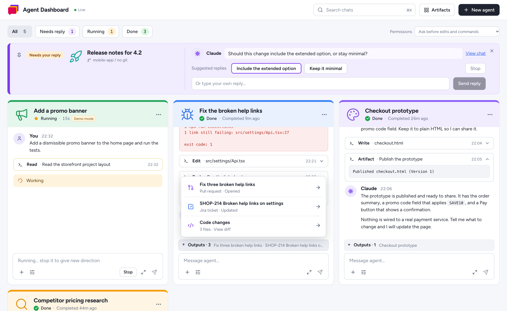
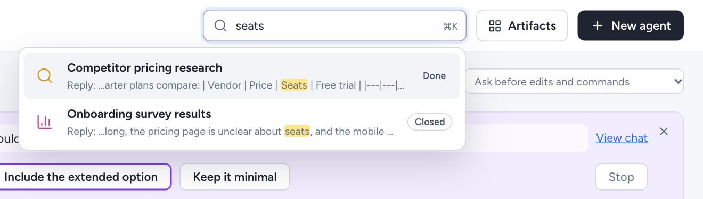

# Agent Dashboard for Claude Code

One page for every Claude Code agent you have running. Start an agent in a project folder, watch
what it is doing, answer when it needs you, and find any past chat again, without hunting
through editor windows and terminals.

It is built for product managers and anyone else who uses Claude Code to **research**, **build
prototypes** and **update code**, often several things at once. It runs on your own machine, and
your chats stay there.



_Sample chats, with the running agent in demo mode._

## What you get

- **Every agent on one page.** Each chat is a card with a title, a topic icon, a status and the
  conversation itself. Chats you already have open in VS Code or a terminal appear on their own.
- **A banner when an agent needs you.** Its question, the replies it suggests and a box for your
  own, above everything else.
- **Readable progress.** Messages read as a chat. Each tool step is one row that opens onto what
  came back; file edits show the lines removed and added; failures are marked.
- **Search across everything** (⌘K): titles, your prompts and the replies, in open and closed
  chats.

  

- **Outputs on every chat.** What a chat made (pages, tickets, pull requests, published
  artifacts, files, code changes) sits at the foot of its card, one click from opening.
- **An artifact library.** Every page an agent published and every prototype, PDF, spreadsheet,
  document and deck it made, on one page with a small live look at each and its own search.
- **Start with just a folder.** Pick the project folder and type. The chat names itself from
  your first prompt and picks an icon for the kind of work.
- **Attach anything.** Paste or drop screenshots, PDFs, CSVs and other files into a prompt.
- **Arrange it your way.** Rename chats, change their icons, drag cards into order, pin the ones
  you live in, close the ones you are done with and reopen them later.
- **One permissions switch** for every agent, from "ask before edits and commands" to "auto".

## Before you start

- **Claude Code**, installed and signed in. If `claude` works in your terminal, you are set.
- **Node.js 22** or newer.
- macOS, Linux or Windows. The native folder chooser is macOS only; elsewhere you type or paste
  the folder path.

## Quick start

```sh
git clone https://github.com/t--becker/claude-code-agent-dashboard.git
cd claude-code-agent-dashboard
npm install
npm run build
npm start
```

Open http://127.0.0.1:4848. Press **New agent**, choose a project folder, and type what you want
done.

To try it without Claude Code, run `FORCE_DEMO=1 npm start`: agents are simulated and nothing on
disk is changed.

## Three ways people use it

**Research.** Start an agent in a notes folder and ask it to compare options, read a set of
documents or summarise an export. Attach the files. Keep the chat pinned while you work, and
search for it later by anything that was said in it.

**Prototypes.** Start an agent in an empty folder and describe the screen or flow you want.
Links to files the agent creates open from the chat, so a page it builds is one click away.
Reply in the same card to change it.

**Code updates.** Start an agent in the repository and describe the change. Watch the edits as
they happen, answer permission questions from the banner, and run several of these side by side.

## Using it

- **The page.** Agents waiting for your reply come first, each as a banner with the question, the
  replies on offer and a box for your own. Below is one grid with a card for every open agent,
  running or finished, in the order you arranged them. **Closed sessions** at the bottom holds
  the cards you closed yourself, each ready to reopen.
- **Search.** The box at the top (⌘K, or Ctrl+K) looks through every chat the workspace holds,
  open and closed: titles, project names, your prompts, the replies and the tool steps. Every
  word you type must appear in the title or in one message. Chats matched by title come first,
  then the most recently active. Enter or a click opens the chat in the full view; a closed
  chat is reopened first. It searches what the workspace keeps of each chat, which for a very long one is its most recent 1,500 to 2,000 entries.
- **Chips.** All, Running and Done filter the page and count the open agents; Needs reply joins
  them when an agent is waiting. Done covers finished, stopped and failed.
- **The "…" on a card** holds Open chat, Pin, Rename, Change icon and Close. Double-clicking the
  title also renames; clicking the icon also changes it; the arrows in the message box also open
  the full view; the sliders there show the model and permissions for the next prompt.
- **Topic icon.** Each chat has an icon left of its title, in the chat's own colour, for the kind
  of work it holds. It is suggested from the title and the first prompt (`shared/topics.ts`:
  keywords per topic, the title weighted above the prompt), never from the repo, since unrelated
  chats share one. A chat still named after its folder shows the general icon until its first
  prompt. Click the icon to pick another: your pick is saved with the chat and nothing replaces
  it, and the picker offers the suggestion back. Until you pick, a rename can change the
  suggestion; later prompts do not. The same icon shows on the card, in the full view, on the
  reply banner, in search results and in the Closed sessions list. Topics are line icons from lucide. To use a logo of your own for a topic, put a picture named
  after the topic id in `~/.agent-workspace/logos`, for example `rcs.png` or `whatsapp.png`
  (`.png`, `.jpg` or `.webp`, up to 1 MB); the ids are listed in `shared/topics.ts`.
- **Outputs.** When a chat has made something, a bar above its message box says how many things
  and names them; click it for the list. It is worked out from the agent's tool calls: Confluence
  pages and Jira tickets created or updated, pull requests and issues opened with `gh`, pages
  published with the Artifact tool, Slack messages, Miro boards, files written, and any other
  connected tool that says it creates something and answers with an address. Each opens in a new
  tab. Edited source files are grouped as **Code changes**, which opens the edits themselves.
  Only successful calls count, and a thing touched twice is listed once. Changes an agent makes
  by running a script are not seen, only its own edit and write steps.
- **Artifacts** (in the header) opens the library of what your agents made. It is read out of
  Claude Code's saved chats on this machine: pages published with the Artifact tool, files an
  agent wrote, and files a reply pointed you to (HTML, PDF, XLSX, CSV, DOCX, PPTX). A published
  page opens on claude.ai; a file opens from your computer. Pages and PDFs show a live preview and
  CSVs their first rows. A copy of each published page's source is kept in
  `~/.agent-workspace/artifacts`, so its preview survives the temporary folder it was written
  in; a page published before you installed the dashboard, whose source is already gone, shows a
  placeholder. The library does not talk to claude.ai, so a page you delete there by hand stays
  listed.
- **Pin.** Pinning a card (from its menu) keeps it at the front of the grid; a pinned card shows
  a pin beside its title, which unpins it.
- **Your picture.** Put a picture at `~/.agent-workspace/avatar.png` (or `.jpg`, `.webp`, `.gif`,
  up to 2 MB) and it shows beside your messages. The server only reads that file; it never
  fetches a picture from the internet. Without one, your messages get a plain person icon.
- **Open chat** (or the arrows in the message box) gives one agent the whole page, with its
  model, permissions and folder. Escape, Shrink or ← All agents goes back.
- **New agent** asks for one thing: the project folder. On macOS it opens the system folder
  chooser, starting in the repos folder; elsewhere, or with `FOLDER_PICKER=off`, it asks for the
  path on the page. The card opens ready for your first prompt, on Claude Code with the default
  model and the workspace's permission mode. Model and permissions can be changed afterwards in
  the card's expanded view.
- **Titles.** A new card is named after its folder until you send the first prompt, which names
  it. Rename any card with the pencil beside its title, or by double-clicking the title: Enter
  saves, Escape cancels. A name you give is never replaced.
- **Order.** Drag a card by its header onto another card to put it there. The order is remembered
  in this browser. A card you have not placed yet (a new agent, a chat just mirrored in) appears
  first.
- **Files.** Paste a file into the prompt box, drop files anywhere on the card, or use the **+** button.
  Any type, up to 10 per prompt, 20 MB each and 50 MB together. PNG, JPEG, GIF and WebP pictures
  up to 5 MB are shown to Claude Code as pictures (larger ones are scaled down first). Every other
  file is saved and Claude Code is given its path, which it opens with its own tools, so what it
  can make of a file is what Claude Code can read: text, code, CSV, PDF, notebooks and the like.
  Files show on your prompt in the transcript, are kept in
  `~/.agent-workspace/attachments/<card id>` and are deleted when you delete the card. Codex is
  given the saved paths for everything.

## Safety

Read this before you change any defaults.

This server can start agents with every permission check off and can read files under the repos
folder, and it has no login. It is safe only as a tool for one person on their own machine.

- **Other machines** cannot reach it: it listens on `127.0.0.1`. Setting `HOST` to anything else
  removes that protection, and the server prints a warning when you do. Do not expose it.
- **Web pages in your own browser** can send requests to localhost, so every API request and the
  live socket are checked (`server/security.ts`): the `Host` header must be this server, the
  `Origin` must be the workspace's own page, requests the browser marks cross-site are refused,
  and anything that changes state must be sent as JSON. Together these stop another site from
  reading your chats or starting an agent, including through DNS rebinding.
- **Files**: the file route serves only regular files under the repos folder, session folders and
  the temp folders, never a hidden file or folder (`.env`, `.git`, `.ssh`, `.claude`). Served HTML
  runs sandboxed in its own origin.
- **Agent replies** are rendered as Markdown with raw HTML ignored. Pictures hosted on another
  site are shown as a link, never loaded, so a reply cannot leak text through an image address.
- **Saved transcripts** in `~/.agent-workspace` hold whatever the agents read. The folder and
  `sessions.json` are readable by your user only, and none of it belongs in git.

Other programs running as you on this machine are trusted: a request with no `Origin` header
(curl, a script) is allowed.

## Settings

Set these as environment variables when you start the server.

| Variable            | Default                         | Meaning                                              |
| ------------------- | ------------------------------- | ---------------------------------------------------- |
| `PORT` / `HOST`     | `4848` / `127.0.0.1`            | Where the server listens. Keep `HOST` on localhost.  |
| `REPO_ROOT`         | your projects folder, else home | Where the folder chooser starts                      |
| `DATA_DIR`          | `~/.agent-workspace`            | Where chats, settings and attachments are kept       |
| `AUTO_MIRROR`       | on                              | `0` stops chats open elsewhere appearing on the page |
| `FOLDER_PICKER`     | on (macOS only)                 | `off` asks for the folder on the page instead        |
| `FORCE_DEMO`        | unset                           | `1` simulates every agent                            |
| `DEMO_TURN_MS`      | `6000`                          | Length of a simulated turn                           |
| `CLAUDE_EXECUTABLE` | the SDK's bundled CLI           | Path to a specific `claude` binary                   |

`REPO_ROOT` defaults to the first of `~/repo`, `~/repos`, `~/projects`, `~/code`, `~/dev`,
`~/src`, `~/Developer` or `~/Documents` that exists.

## Good to know

- It is a tool for one person on one machine. There is no login and no sharing.
- A chat that is running in VS Code or a terminal is mirrored, not controlled: you can read it
  here, and sending a prompt from its card continues it here as a separate branch.
- The server must be running for the page to work. Chats are saved, so restarting loses nothing
  except a turn that was in progress.
- Topic icons are suggested by matching keywords, so they are sometimes off. Click one to change
  it.
- Codex support is experimental.

More detail on how it works is in [docs/reference.md](docs/reference.md).

## Developing

```sh
npm run dev            # server on :4848, page with hot reload on :5173
npm run typecheck && npm run lint && npm run format:check
npm test               # unit tests (Vitest)
npm run test:e2e       # browser tests (Playwright, uses the installed Google Chrome)
```

## Licence

[MIT](LICENSE).

## Not affiliated with Anthropic

This is an independent project. Claude and Claude Code are products of Anthropic. The dashboard
talks to Claude Code through the Claude Agent SDK, using the Claude Code login already on your
machine.
